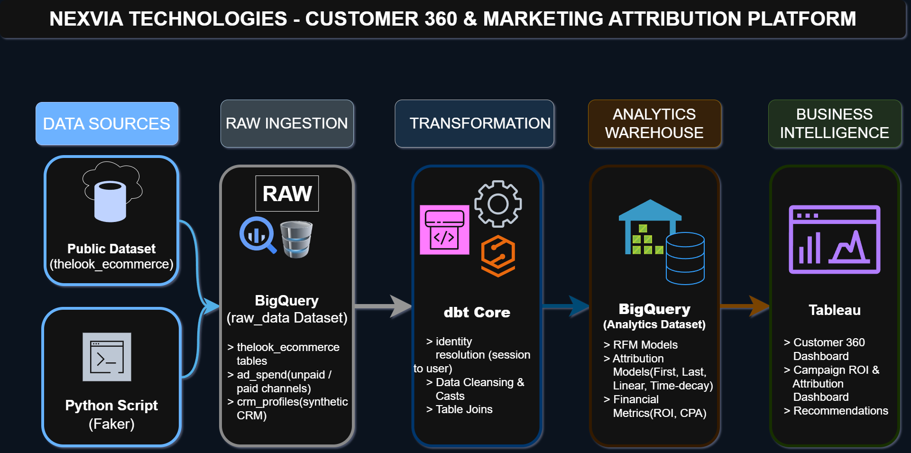
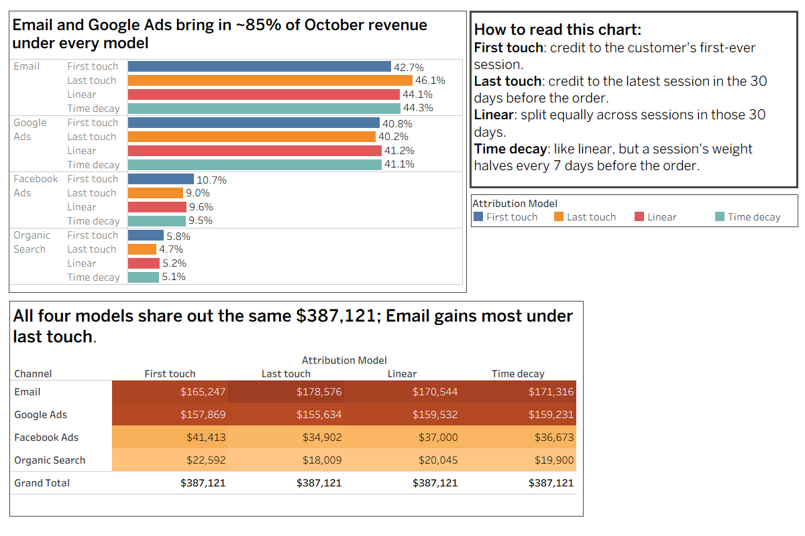
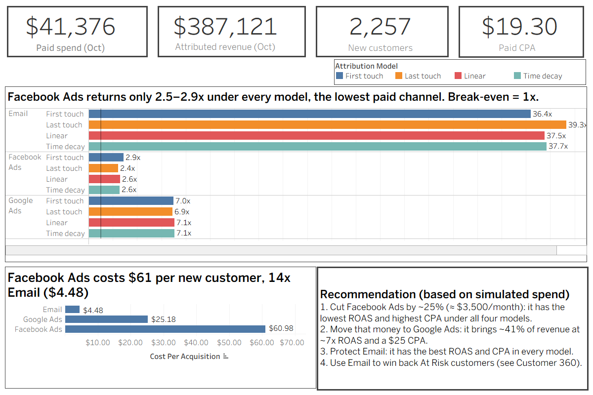
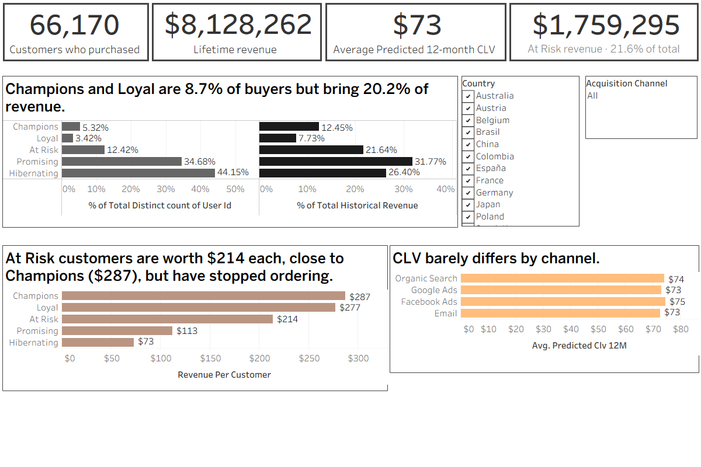

# Customer 360 & Marketing Attribution

Built during my data analyst internship at Nexvia Technologies.

**Business question:** which marketing channels actually bring in revenue, who are our most valuable customers, and where should next month's budget go?

The project combines website sessions, orders, CRM profiles and ad spend into one customer view in BigQuery, models it with dbt, compares four attribution models, and presents the results in Tableau.



---

## Data

| Source | What it contains | Real or synthetic |
|---|---|---|
| `bigquery-public-data.thelook_ecommerce` | Users, orders, order items, web events with traffic source | Real (public sample e-commerce data) |
| `raw_data.ad_spend` | Daily spend, impressions, clicks per channel, 1–31 Oct 2026 | Synthetic, `scripts/generate_data.py` |
| `raw_data.crm_profiles` | Persona, account manager, loyalty score per user | Synthetic, `scripts/generate_data.py` |

**Why thelook:** it was one of the dataset options for this project. I chose it because users, orders and web events all share a `user_id`, so sessions, orders and CRM data can be joined into one customer view.

**Segment:** not used. In production, Segment would collect web/app events and link anonymous visitors to customers. Here, thelook's events table plays that role and the Python script generates the CRM and ad-spend data.

**Channel mapping:** thelook traffic sources are mapped to ad channels in `nexvia_dbt/seeds/channel_mapping.csv` (Adwords and YouTube → Google Ads, Facebook → Facebook Ads, Email → Email, Organic → Organic Search).

---

## How it works

1. **Load** – `generate_data.py` creates the synthetic ad-spend and CRM tables (seeded, so every run gives the same data) and loads them into BigQuery.
2. **Staging** – `stg_*` models rename and cast every source table.
3. **Identity step** – `int_events__user_resolved` gives every event the user of its session; a test checks that no session belongs to two users. Anonymous sessions stay anonymous and are excluded from attribution.
4. **Sessions, orders, customers** – `fct_sessions`, `fct_orders`, and `dim_customers` (the Customer 360 table).
5. **RFM & CLV** – `mart_customer_rfm` scores every customer 1–5 on recency, frequency and monetary value, predicts 12-month CLV, and assigns a segment.
6. **Attribution** – `mart_marketing_attribution` credits October's order revenue to channels under four models and adds spend and CPA; `mart_attribution_by_model` puts the models side by side with ROAS and ROI.
7. **Dashboards** – Tableau reads the mart and analytics tables.

---

## KPI definitions

| KPI | Definition |
|---|---|
| Net revenue | Sum of `sale_price` for items that were not cancelled or returned |
| First touch | 100% of an order's revenue goes to the channel of the customer's earliest session before the order |
| Last touch | 100% goes to the latest session in the 30 days before the order |
| Linear | Revenue is split equally across all sessions in the 30 days before the order |
| Time decay | Like linear, but a session's weight halves for every 7 days before the order |
| Unattributed | Orders with no identified session before them (in the 30-day lookback for last touch, linear and time decay) |
| ROAS | Attributed revenue ÷ spend |
| ROI | (Attributed revenue − spend) ÷ spend. Revenue-based: product costs are not included |
| CPA | Spend ÷ customers acquired. A customer is acquired when their first-ever session and an order both fall in October. Empty for Organic Search (no spend) |
| CTR | SUM(clicks) ÷ SUM(impressions) |
| Recency / Frequency / Monetary score | 1–5. Recency and monetary are quintiles; frequency is the number of orders capped at 5, because most customers have only 1–2 orders and quintiles would split identical customers |
| Predicted 12-month CLV | Average order value × orders per year. Tenure is floored at one year so new customers aren't over-projected |
| Segments | Champions (R ≥ 4, F ≥ 3), Loyal (F ≥ 3), At Risk (R ≤ 2, M ≥ 4), Promising (R ≥ 4), Hibernating (everyone else who has purchased), Never purchased |

---

## Results

Window: 1–31 October 2026. All four attribution models share out the same **$387,120.57** of net revenue (checked by a dbt test).

| Channel | Spend | First touch | Last touch | Linear | Time decay | ROAS (linear) | New customers | CPA |
|---|---|---|---|---|---|---|---|---|
| Email | $4,542 | 42.7% | 46.1% | 44.1% | 44.3% | 37.5x | 1,014 | $4.48 |
| Google Ads | $22,564 | 40.8% | 40.2% | 41.2% | 41.1% | 7.1x | 896 | $25.18 |
| Facebook Ads | $14,270 | 10.7% | 9.0% | 9.6% | 9.5% | 2.6x | 234 | $60.98 |
| Organic Search | $0 | 5.8% | 4.7% | 5.2% | 5.1% | n/a | 113 | n/a |

(Percentages = share of October revenue under each model.)

- **Email and Google Ads bring in about 85% of revenue under every model.**
- **The four models agree closely.** The biggest gap is Email: 42.7% under first touch vs 46.1% under last touch, so it gets more credit for *finishing* purchases. Facebook Ads and Organic Search get slightly more credit under first touch, so they play more of a role in *starting* customer journeys.
- **0% of revenue is unattributed:** every October order had an identified session before it.
- **Facebook Ads is the weakest paid channel:** ROAS 2.5–2.9x across the four models and a CPA of $61, about 14x Email's.
- **Customer value is concentrated.** Of 66,170 customers who have purchased, Champions and Loyal are just 8.7% but bring in 20.2% of lifetime revenue ($287 and $277 per customer vs $73 for Hibernating).
- **8,220 high-value customers are At Risk** (12.4% of buyers, 21.6% of revenue, $214 each): they spent a lot but haven't ordered recently. 33,830 users (34%) have never purchased.

| Segment | Customers | % of buyers | Lifetime revenue | % of revenue |
|---|---|---|---|---|
| Champions | 3,521 | 5.3% | $1,011,915 | 12.4% |
| Loyal | 2,266 | 3.4% | $628,417 | 7.7% |
| At Risk | 8,220 | 12.4% | $1,759,295 | 21.6% |
| Promising | 22,947 | 34.7% | $2,582,526 | 31.8% |
| Hibernating | 29,216 | 44.2% | $2,146,109 | 26.4% |
| Never purchased | 33,830 | – | $0 | – |

### Recommendations (based on simulated spend)

These hold under all four attribution models:

1. **Cut Facebook Ads by about 25% (≈ $3,500/month).** It has the lowest ROAS and highest CPA under every model. Keep the rest, because it gets more credit under first touch, which suggests it helps start customer journeys.
2. **Move that budget to Google Ads.** It brings ~41% of revenue in every model at ~7x ROAS and a $25 CPA, so it has the most room to scale.
3. **Protect Email.** It has the highest ROAS and lowest CPA in every model; invest in growing the email list rather than cutting spend.
4. **Use Email to win back At Risk customers.** They hold 21.6% of lifetime revenue, and Email is the cheapest channel per new customer ($4.48), so a re-engagement campaign aimed at this segment is the lowest-cost way to protect that revenue.

Because spend is simulated, these show how the analysis would drive a budget decision; real spend data (and ideally a holdout test) would be needed before acting on them.

### Dashboards

- **Workbook:** `Dashboards/Customer_360_Marketing_Attribution.twbx`. It is a packaged workbook with the data extracts included, so it opens in the free [Tableau Reader](https://www.tableau.com/products/reader) without BigQuery access.
- **Demo recording:** [link to be added]
- **Presentation:** `docs/Customer 360 & Marketing Attribution – Presentation.pptx`

| Attribution comparison | ROI & CPA | Customer 360 |
|---|---|---|
|  |  |  |

---

## Data quality tests

`dbt build` builds 15 models and 1 seed and runs **76 data tests: 76 pass, 0 warnings, 0 failures** (run on 16 Nov 2026). Highlights:

| Test | Why it matters |
|---|---|
| `assert_attribution_revenue_reconciles` | Every attribution model hands out exactly October's net revenue, so no revenue is lost or double counted |
| `assert_mart_revenue_matches_staging` | Total customer revenue in the RFM mart equals source order revenue |
| `assert_one_user_per_session` | The identity step never assigns a session to two users |
| `unique` / `not_null` / `relationships` | Keys are unique and every CRM profile, order and session joins to a real user |
| `accepted_values` / `accepted_range` | Channels, statuses, segments and RFM scores only take valid values |

---

## Limitations

- **Ad spend is synthetic.** Revenue and sessions are real thelook data, but spend is simulated from planned daily budgets, so ROI and CPA show the method, not real channel performance.
- **ROI is revenue-based**, not profit-based.
- **Anonymous sessions are excluded** from attribution, which can under-credit channels that bring visitors who don't sign in.
- **Attribution is not causation.** A holdout test would be needed to prove a channel causes extra sales.
- thelook is a public sample dataset that is refreshed over time, so exact numbers can change between runs.

---

## How to run

**Prerequisites:** Python 3.9+, a Google Cloud project with BigQuery enabled, and a service-account JSON key.

1. Clone the repo and install dependencies:
   ```bash
   pip install -r requirements.txt
   ```
2. Point to your key (or save it as `gcp-key.json` in the repo root – it's gitignored):
   - Windows (cmd): `set GOOGLE_APPLICATION_CREDENTIALS=C:\path\to\gcp-key.json`
   - Windows (PowerShell): `$env:GOOGLE_APPLICATION_CREDENTIALS="C:\path\to\gcp-key.json"`
   - Mac/Linux: `export GOOGLE_APPLICATION_CREDENTIALS=/path/to/gcp-key.json`
3. Set `PROJECT_ID` in `scripts/generate_data.py` to your GCP project, then load the synthetic data:
   ```bash
   python scripts/generate_data.py
   ```
4. Create `~/.dbt/profiles.yml`:
   ```yaml
   nexvia_dbt:
     target: dev
     outputs:
       dev:
         type: bigquery
         method: service-account
         project: your-gcp-project-id
         dataset: analytics
         keyfile: /path/to/gcp-key.json
         location: US        # thelook is stored in the US
         threads: 4
   ```
5. Build and test everything – **run this from the `nexvia_dbt` folder**:
   ```bash
   cd nexvia_dbt
   dbt deps
   dbt build
   ```

---

## Project structure

```text
├── Dashboards/                 Tableau workbook
├── docs/                       Architecture diagram (.drawio + .png), dashboard screenshots, presentation
├── nexvia_dbt/
│   ├── models/
│   │   ├── staging/            stg_* models + sources and tests
│   │   ├── intermediate/       identity step and sessions
│   │   ├── marts/              fct_sessions, fct_orders, RFM/CLV, attribution
│   │   └── analytics/          dim_customers (Customer 360), fct_marketing_spend
│   ├── seeds/                  channel_mapping.csv
│   └── tests/                  reconciliation and identity tests
├── scripts/generate_data.py    synthetic ad-spend and CRM data
├── REFLECTION.md               my individual reflection
├── requirements.txt
└── README.md
```
