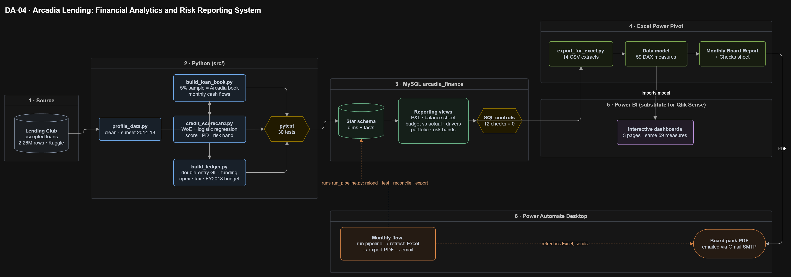
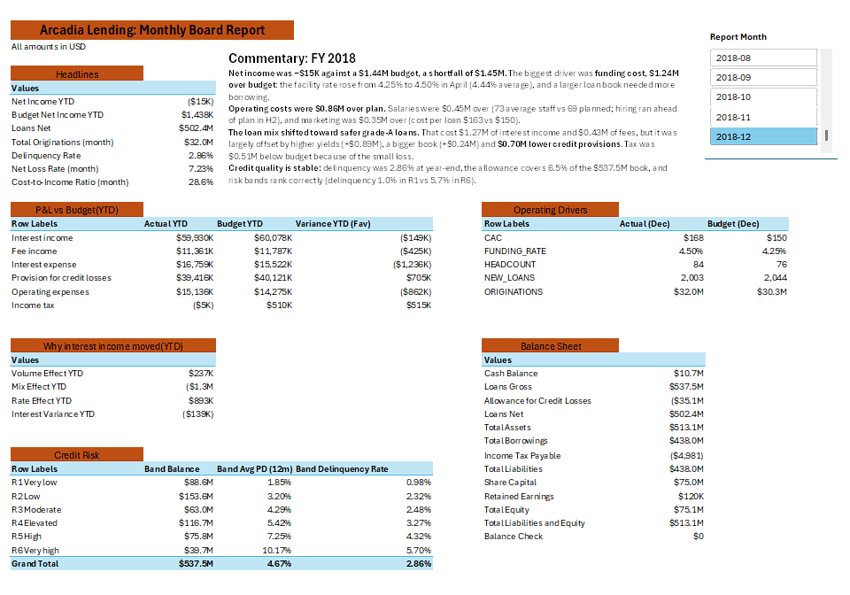
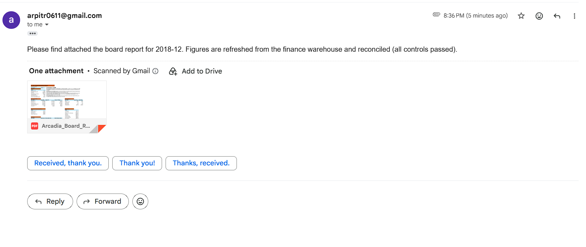
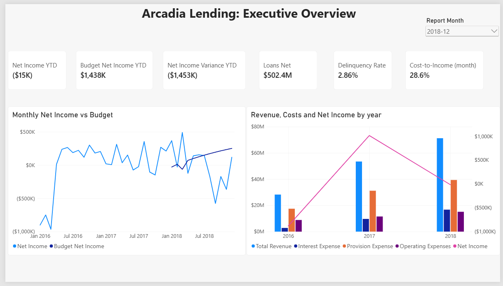
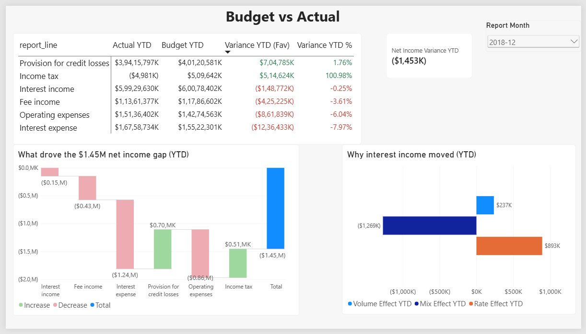
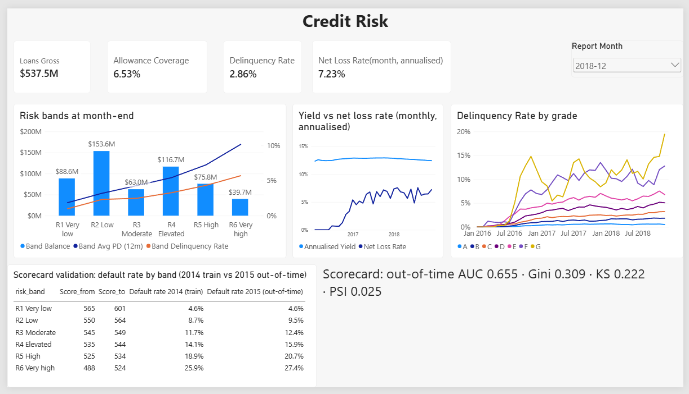
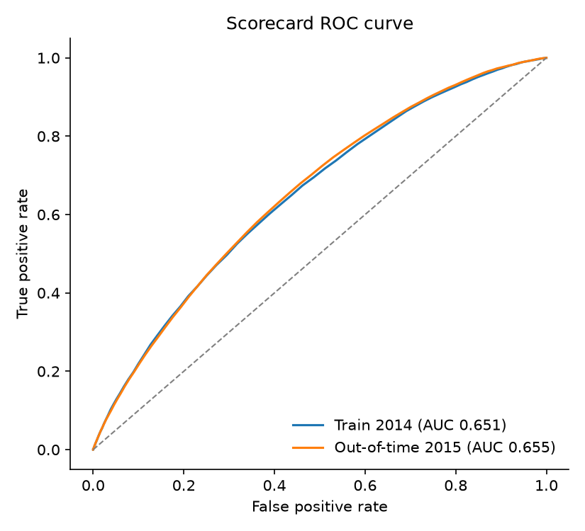
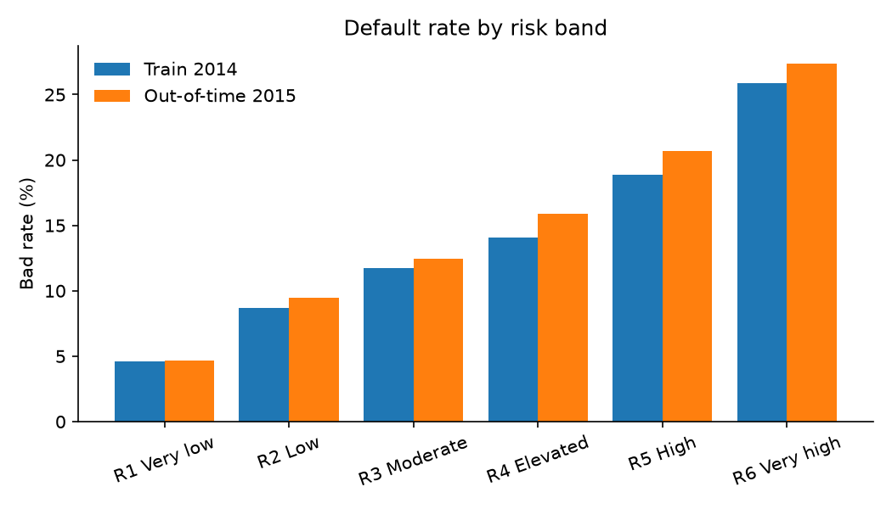

# DA-04 · Financial Analytics and Risk Reporting System

Automated finance and credit-risk reporting for **Arcadia Lending**, a fictional consumer lender
whose loan book is real Lending Club data. One command rebuilds the warehouse, tests it, reconciles
it and refreshes the reports; Power Automate then emails the monthly board pack as a PDF.

| | |
|---|---|
| **Stack** | Python · MySQL · Excel Power Pivot (DAX) · Power BI (in place of Qlik Sense, see §2) · Power Automate Desktop |
| **Data** | 2.26M Lending Club loans (2007–2018) → 68,661-loan book, $1.05bn lent 2016–2018 |
| **Outputs** | P&L, balance sheet, budget vs actual with variance drivers, credit scorecard with risk bands, interactive dashboards, monthly board report PDF |
| **Quality** | 30 automated tests + 12 SQL controls, all passing; every report reconciles to the source to the cent |

---

## 1. The problem

A lender's finance team builds its monthly board pack by hand: copying numbers between
spreadsheets, re-keying them, and hoping the P&L, the balance sheet and the loan book agree.
It is slow, and nobody fully trusts the numbers.

This project replaces that with a pipeline in which every number is **derived from the loan data,
defined in one place, tested, and reconciled**, and the board pack is produced and emailed
automatically.

## 2. What it does

| Brief requirement | Delivered | Where |
|---|---|---|
| 1. Public financial / loan dataset | Lending Club accepted loans + synthetic operating costs and budget | `src/profile_data.py`, `src/build_loan_book.py` |
| 2. P&L and balance-sheet summaries with **SQL** and **Power Pivot** | Double-entry general ledger → SQL views → Power Pivot model with 59 DAX measures, reconciled to SQL | `sql/04_reporting_views.sql`, `excel/` |
| 3. Budget vs actual with clear drivers | FY2018 budget; variances explained by volume / mix / rate effects and operating KPIs | `vw_budget_vs_actual`, `vw_interest_variance_drivers`, `vw_kpi_variance` |
| 4. Credit scorecard (logistic regression, WoE) with risk bands | Out-of-time AUC 0.655; six risk bands; PDs drive the loan-loss allowance | `src/credit_scorecard.py`, `reports/scorecard/` |
| 5. Interactive dashboards in **Qlik Sense** | ⚠️ **Delivered in Power BI instead** (see note below): 3-page interactive report (executive overview, budget vs actual, credit risk) on the same tested data model | `powerbi/` |
| 6. **Power Automate**: refresh and email the board report as PDF | Desktop flow: run pipeline → refresh Excel → export PDF → email via Gmail SMTP, with failure alerts | `automation/` |
| 7. Definitions of every metric | Formula, source, unit and sign convention for every number | [`docs/metric_definitions.md`](docs/metric_definitions.md) |

> **Note on Qlik Sense.** Qlik's free trial only accepts business email addresses. Company access
> was requested on 12 Nov 2026 and was not available before submission. To deliver working
> interactive dashboards, they were built in **Power BI Desktop**, which imports the Excel Power
> Pivot model directly: the same 14 tables, relationships and 59 DAX measures. So the dashboards
> show exactly the numbers reconciled in Excel and SQL. The dashboard design (pages, visuals,
> measures) is tool-agnostic and would carry over to Qlik Sense once access is granted.

## 3. Architecture



1. **Python** turns lifetime loan totals into monthly cash flows, scores every loan, and posts a
   double-entry general ledger (loans, funding, operating costs, provisions, tax) plus a FY2018 budget.
2. **MySQL** holds a star schema (5 dimensions, 6 fact tables) and the reporting views. SQL controls
   check that the books balance and agree with the loan sub-ledger.
3. **Excel Power Pivot** loads a CSV extract of the warehouse, recomputes every metric in DAX,
   reconciles itself to SQL, and lays out a one-page monthly board report.
4. **Power BI** imports the same Power Pivot model for interactive dashboards (substitute for Qlik Sense).
5. **Power Automate Desktop** runs the whole refresh and emails the PDF.

Why a CSV extract for Excel? The MySQL connector is missing from some Office editions and needs a
driver. CSVs work in every Excel, let anyone refresh the workbook without a database, and make the
automation simpler.

Full table and column reference: [`docs/data_dictionary.md`](docs/data_dictionary.md).

## 4. Results

### FY2018 board story
**Net income −$15K against a $1.44M budget: a $1.45M shortfall.**

| Driver | Variance (fav +) | Why |
|---|---|---|
| Interest expense | −$1.24M | Facility rate rose from 4.25% to 4.50% in April; larger book needed more borrowing |
| Operating expenses | −$0.86M | 73 average staff vs 69 planned; cost per loan acquired $163 vs $150 |
| Fee income | −$0.43M | Mix shifted toward grade-A loans, which pay a 1% origination fee |
| Interest income | −$0.14M | Volume +$0.24M, **mix −$1.27M**, rate +$0.89M |
| Provision for credit losses | +$0.70M | Safer loan mix needs a smaller allowance |
| Income tax | +$0.51M | Small loss, so no tax |

Year-end 2018: loans $537.5M (gross), allowance covering 6.5%, delinquency 2.86%, equity $75.1M,
cost-to-income 27.8%.



Sample of the emailed PDF: [`docs/sample_board_report_2018-12.pdf`](docs/sample_board_report_2018-12.pdf)

The Power Automate flow delivers it automatically after the refresh and all controls pass:



### Interactive dashboards (Power BI)
Three pages share one month slicer: **Executive overview** (KPIs, monthly net income vs budget,
3-year P&L), **Budget vs actual** (variance by P&L line, waterfall of the $1.45M gap, volume / mix /
rate drivers) and **Credit risk** (risk bands, delinquency by grade, yield vs net loss rate,
scorecard validation).





### Credit scorecard
| Sample | Loans | Bad rate | AUC | Gini | KS |
|---|---|---|---|---|---|
| Train (2014, 70%) | 113,799 | 13.7% | 0.651 | 0.302 | 0.213 |
| Validation (2014, 30%) | 48,771 | 13.7% | 0.648 | 0.297 | 0.220 |
| **Out-of-time (2015)** | 283,026 | 14.9% | **0.655** | **0.309** | **0.222** |
| Benchmark: Lending Club sub-grade | 283,026 | 14.9% | 0.679 | 0.357 | 0.262 |

- Stable on unseen data (train vs out-of-time AUC differ by 0.004); population stability PSI 0.001–0.025.
- Uses **only information known at application**. Lending Club's own grade and interest rate are
  excluded (that would copy their model) and used as the benchmark instead.
- Default rate rises in every band, R1 → R6: 4.6% → 27.4% (2015); delinquency in Arcadia's own
  book 1.0% → 5.7% (Dec-2018).

| Risk band | Score | 2015 default rate |
|---|---|---|
| R1 Very low | 565–601 | 4.6% |
| R2 Low | 550–564 | 9.5% |
| R3 Moderate | 545–549 | 12.4% |
| R4 Elevated | 535–544 | 15.9% |
| R5 High | 525–534 | 20.7% |
| R6 Very high | 488–524 | 27.4% |

<p>


</p>

## 5. Testing and controls

| Layer | Checks | Result |
|---|---|---|
| Loan sub-ledger (`tests/test_loan_book.py`, `sql/03`) | monthly cash flows tie to Lending Club totals; balances roll forward; closed loans end at 0 | **$0.00** difference across 68,661 loans |
| General ledger (`tests/test_ledger.py`, `sql/05`) | every journal balances; balance sheet balances every month; GL = loan sub-ledger; cash ≥ 0; volume + mix + rate = variance | all 0 |
| Scorecard (`tests/test_scorecard.py`) | no leakage; coefficient signs; out-of-time AUC; monotonic bands; PSI < 0.1; points table reproduces every score | pass |
| Excel vs SQL (workbook `Checks` sheet) | net income, total assets, balance check | $0.00 differences |
| Reproducibility | fresh clone + data file → identical numbers on two machines | identical |

Run: `pytest -q` → **30 passed**. `python src/run_pipeline.py` stops at the first failing test or control.

## 6. Setup and run

**Prerequisites:** Windows 10/11 · Python 3.11+ (built with 3.14) · MySQL 8.0+ · Excel 2021 or later / 365
with Power Pivot · Power BI Desktop (free) · Power Automate Desktop (free with Windows 11) · a Kaggle account.

```powershell
# 1. Get the code and install packages
git clone https://github.com/HypeMeArpit/nexvia-technologies-internship-projects.git
cd nexvia-technologies-internship-projects\DA-04
python -m venv .venv
.venv\Scripts\Activate.ps1
pip install -r requirements.txt

# 2. Database credentials (never committed)
copy .env.example .env        # then put your MySQL user and password in .env

# 3. Data: download accepted_2007_to_2018Q4.csv.gz from Kaggle
#    ("Lending Club" by wordsforthewise) into data\raw\  (do not unzip)

# 4. Build everything: extract, loan book, scorecard, ledger, tests, MySQL load, reports, controls, Excel extract
python src\run_pipeline.py --from-raw      # first run (about 20 min)
python src\run_pipeline.py                 # later runs (about 11 min)
python src\run_pipeline.py --skip-build    # reload MySQL and reports from existing data files
```
The run ends with `PIPELINE OK`; any failed test or control stops it with exit code 1.

**Excel board report:** open `excel\Arcadia_Board_Report.xlsx` → **Data → Get Data → Launch Power
Query Editor → Home → Manage Parameters** → set `DataFolder` to your `DA-04\excel\data\` path
(ending with `\`) → **Close & Load** → **Data → Refresh All**. Add `DA-04\excel` as an Excel **Trusted Location**
(File → Options → Trust Center) so refreshes are not blocked. Pick the month with the slicer.
The Power Query code for every table is in `excel\power_query_m.txt`.

**Power BI dashboards:** open `powerbi\Arcadia_Dashboards.pbix` in the free Power BI Desktop →
**Transform data → Edit parameters** → set `DataFolder` to your `DA-04\excel\data\` path → **Refresh**.

**Automation:**
1. Test the refresh and PDF export: `cscript //nologo automation\refresh_and_export.vbs "$PWD\reports\Arcadia_Board_Report_2018-12.pdf"` (PowerShell)
2. In Power Automate Desktop, create a flow, open the designer and paste the contents of
   `automation\board_report_flow.txt` (it recreates every action).
3. Set the `ProjectDir` and `RecipientEmail` variables, and enter a Gmail **App Password** in the
   three Send email actions (Google Account → Security → App passwords). Run the flow.

## 7. Repository layout

```
DA-04/
├── src/                 Python pipeline (run_pipeline.py runs everything in order)
├── sql/                 schema, reference data, reporting views, reconciliation controls
├── tests/               pytest suites: loan book, ledger, scorecard
├── models/              scorecard.json: bins, WoE, points, calibration
├── reports/scorecard/   validation metrics, IV, points table, risk bands, charts
├── excel/               Power Pivot workbook, Power Query code, CSV extract (data/)
├── automation/          refresh_and_export.vbs + Power Automate flow
├── powerbi/             Power BI dashboards (substitute for Qlik Sense, same data model)
└── docs/                metric definitions, data dictionary, architecture, screenshots, sample PDF
```

## 8. Key design decisions

- **Fictional owner, real loans.** Lending Club data is a list of loans with no costs, cash or
  budget. A fictional lender owns a 5% sample, so real borrower behaviour drives the financials.
  Not named "LendingClub", because invented costs under a real company's name would mislead.
- **Monthly cash flows rebuilt from lifetime totals** with amortisation schedules, early payoffs,
  charge-off 5 months after the last payment, and cumulative rounding so totals tie to the cent.
- **Double-entry ledger at month × grade**, with loan-level detail in a sub-ledger; controls prove they agree.
- **Allowance = 12-month expected credit loss** (balance × PD × LGD, 100% PD for delinquent loans),
  with PDs from the scorecard, so the model shows up on the balance sheet.
- **Leakage prevention:** columns are split into application-time and outcome columns from the start.
- **Out-of-time validation** (train 2014, test 2015) instead of only a random split.
- **Variances explained by drivers**, with volume / mix / rate effects that add up exactly.

## 9. Challenges and how they were solved

| Challenge | Solution |
|---|---|
| Monthly cash flows drifted from Lending Club totals by a few cents per loan | Cumulative rounding: totals now tie to the cent, enforced by tests |
| MySQL DECIMAL division left ~10 cents/month unexplained in the variance split | Found by a control; fixed with floating-point maths in the view |
| KS statistic differed between machines (tied scores sorted differently) | Tie-safe KS from the ROC curve; results identical everywhere |
| Excel's MySQL connector unavailable in the installed Office edition | Added a CSV extract step; the workbook became portable |
| Board report PDF clipped labels after automated refresh | PivotTables auto-resized columns on refresh; turned off autofit and fixed the layout |
| Qlik Sense trial requires a business email; company access not available in time | Built the dashboards in Power BI by importing the tested Power Pivot model, so no numbers had to be re-implemented; documented as a substitute |

## 10. Limitations and next steps

- Cash-flow timing is reconstructed (totals are exact, the exact payment month is approximate).
- Operating costs, budget, funding, equity and tax are assumptions or synthetic (fixed seeds, documented in code).
- Origination fees are recognised upfront rather than over the loan's life.
- The scorecard trains on 36-month loans and also scores 60-month loans.
- Scheduling the desktop flow to run monthly needs a paid Power Automate plan; it is started manually.
- Dashboards are in Power BI rather than the required Qlik Sense (access issue above); publishing to the Power BI web service also needs a work account, so the `.pbix` file is shared instead.
- **Next:** rebuild the dashboards in Qlik Sense once access is granted; challenger scorecard with bureau data; lifetime (IFRS 9 stage 2) expected loss;
  scheduled cloud flow; faster MySQL bulk load.

---

**Author:** Arpit Rastogi · Data Analyst Intern, Nexvia Technologies
